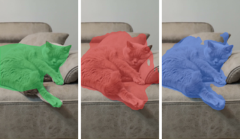
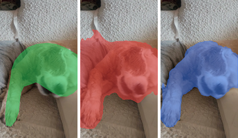
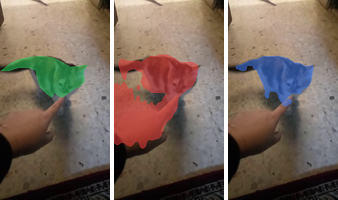
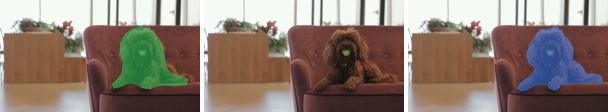
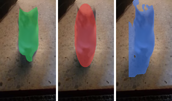
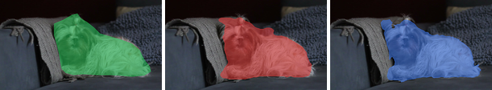

# 리얼뽑기 누끼 품질 조사 (2026-11-27)

**결론:** 동물 누끼가 자주 틀리는 건 **잡은 순간에도 live 윤곽용 90×160 격자 마스크를 그대로 잘라 쓰기 때문**이다.
이 마스크는 DeepLab v3 를 프레임 전체에 257×257 로 돌린 결과다. 잡는 순간(GRIP)에만
**magic touch(이미 APK 에 있음)를 전체 프레임에 한 번 + DeepLab 을 박스 crop 에 한 번** 돌려 합치면,
손으로 만든 GT 17장에서 다음처럼 바뀐다.

| | 현행 | 추천 |
|---|---|---|
| mIoU | 0.657 | **0.785** |
| 경계 F (BF) | 0.427 | **0.613** |
| IoU 0.7 미만인 장 | 6/17 | **2/17** |

APK 크기 변화는 0 이다. 한 번 잡을 때 추가 비용은 폰 기준 약 0.3–0.8 s 로 추정한다. 이미 있는 1.5 s 대기 안에 들어간다.

---

## 1. 지금 누끼가 만들어지는 길 (코드 기준)

```
live (300 ms 마다)                                   GRIP (집게가 닿은 순간)
frame ─► long side 320 ─► DeepLab v3 (내부 257×257)    frozen frame ─► seg.run() 다시 (같은 DeepLab 경로)
        animal 채널 합 > 0.3 을 90×160 격자의            ─► pieceNear(집게 위치)
        칸 중심에서 샘플                                  ─► CutOut.make(): 격자 3×3 blur ─► bilinear 확대
        비면 EfficientDet 박스 안 타원                       (사람만 selfie 모델 personAlpha 경로)
        Tracker 가 4 프레임 유지
```

- `Segmenter.run()` 은 0/1 마스크를 90×160 격자로만 낸다. 1 칸이 1080p 프레임에서 약 12 px 이다.
- 동물을 잡을 때 `CatchScreen.makeGrip()` 은 `CutOut.make(f, m)` 만 부른다. `hiRes` 경로(`personAlpha`)는 PERSON 에만 붙어 있다.
  그래서 **도감·캡슐에 들어가는 동물 그림의 외곽이 live 윤곽과 같은 해상도**다.
- `Segmenter.kt` 의 detector fallback 은 `a.area == 0` 일 때만 탄다. DeepLab 이 몇 칸이라도 잡으면 그 몇 칸이 곧 마스크가 된다.

## 2. 실패 유형 (17장, 사진 왼쪽→오른쪽: GT 초록 | 현행 빨강 | 추천 파랑)

| 유형 | 예 | 현행 IoU → 추천 | 원인 |
|---|---|---|---|
| ① **소파·담요로 번짐** |  src02 회색 고양이·회색 소파 | 0.63 → 0.76 | DeepLab 257 px 에서는 털 결과 천 결이 같은 질감이다. 0.3 문턱이 낮아 배경까지 동물이 된다 (FP/GT 0.55) |
| |  src06 담요 위 개 | 0.62 → 0.80 | 같은 원인 (FP/GT 0.60) |
| ② **사람 손이 동물에 붙음** |  kitten_9 | 0.33 → 0.78 | DeepLab 이 고양이 옆 손을 cat 채널로 칠한다. 둘이 붙어 한 덩어리가 된다 (FP/GT 1.84) |
| ③ **거의 못 잡음** |  g01 붉은 소파 위 갈색 개 | 0.01 → 0.83 | 저대비 배경이라 DeepLab 이 몇 칸만 잡는다. area > 0 이라 detector fallback(개 0.66)도 안 탄다 |
| ④ **모션 블러 → 타원** |  kitten_2 | 0.73 → **0.57** | DeepLab 이 비어서 타원이 대신 들어간다. 도감 그림이 "타원으로 오린 사진"이 된다. 추천 경로는 번진 몸통 일부만 잡아 **오히려 나빠진 유일한 장**이다. 블러 프레임은 어느 쪽도 답이 아니다 → GRIP 프레임을 블러가 적은 직전 프레임에서 고르는 게 별도 과제 |
| ⑤ 뭉툭한 외곽 (전부) | (위 모든 빨강) | BF 0.43 → 0.61 | 90×160 격자 + 3×3 blur. 귀·다리·꼬리가 뭉개진다 |
| ⑥ (추천 쪽 약점) 한 점 magic touch 가 일부만 |  src05 | 0.84 → 0.83 | magic touch 를 seed 한 점에만 주면 몸통만 잡히고 머리가 빠진다 (c2 0.51). crop DeepLab 의 확신 영역(>0.8)과 합쳐 메운다 |

추가 관찰:
- **종류 오판:** kitten_5p7 의 흐린 새끼고양이를 EfficientDet 이 bird 0.28 로 본다. 모든 방법이 실패한 유일한 장이고, 이 문서의 범위(외곽 품질) 밖이다.
- **저조도:** src05 어두운 침대 위 시츄는 현행도 0.84 로 괜찮았다. 실패 대부분은 어두움이 아니라 **비슷한 색·질감의 천**과 **붙어 있는 다른 것**(손·소파)에서 나온다.

## 3. 측정 방법

- **입력 17장.** 운영자 폴더 `reel/render/mont/` 의 반려동물 사진 10장(src00–06, f01, f03, g01), `research/claw-media` 영상 프레임 6장(kitten×3, puppy×2, dog-wag×1), `research/small-animals/guineapig_04` 1장. 모두 긴 변 640 으로 맞췄다.
  hamster_00 은 햄스터가 보이지 않아 뺐다.
- **GT.** 같은 작업자가 화면에 40 px 격자를 깔고 다각형(19–48점)을 손으로 찍었다. 겹친 그림으로 다시 확인했다.
  정밀도는 대략 ±5 px 다. 그래서 경계 F 는 허용오차를 대각선의 1 %(약 7 px)로 잡았다.
  여러 마리가 있는 장(puppy)은 집게가 잡을 한 마리만 GT 다. 재현 파일: `seg-quality/bench/poly.json`, `prep.py`.
- **실행 환경.** headless Chrome 1개, 이미지마다 새로 띄움.
  - MediaPipe tasks-vision 0.10.14 를 CPU delegate 로 돌렸다. 모델은 앱 `assets/models` 의 파일을 그대로 썼다.
  - u2netp·EfficientSAM 은 onnxruntime-web 1.20.1 (wasm, 1 thread).
  - 스크립트: `seg-quality/bench/run.html`, `drive.mjs`, `eval.py`.
- **"현행" 재현 (`eval.py` `grid_app`).**
  - 긴 변 320 에서 DeepLab 을 돌려 animal 채널 합을 낸다.
  - 90×160 칸 중심을 샘플하고 0.3 문턱을 적용한다. 비면 박스 타원으로 대신한다.
  - 집게 지점에 가장 가까운 조각을 고른다. 집게 지점은 GT 의 가장 안쪽 점으로 잡았다.
  - 3×3 blur 후 bilinear 확대하고 alpha 0.5 로 자른다.
- **잡을 때 쓰는 박스.** EfficientDet 동물 박스(≥0.3)를 쓰고, 없으면 DeepLab 마스크 박스를 쓴다. 여기에 15 % 여백을 붙인다.
  앱에서는 live 추적 마스크의 박스가 이미 있으므로 이보다 나은 조건이다.
- **seed (magic touch 를 누를 점).** 박스 crop 위 DeepLab 확신을 3×3 평균한 값이 가장 큰 점이다. 박스 중심에서 멀수록 조금 깎는다.

## 4. 결과

| 방법 | mIoU | 중앙 IoU | IoU<0.7 | BF@1% | FP/GT | FN/GT | 시간 (데스크톱 wasm 1T) |
|---|---|---|---|---|---|---|---|
| a 현행 (DeepLab 전체 → 90×160 격자) | 0.657 | 0.770 | 6/17 | 0.427 | 0.251 | 0.206 | DeepLab 652 ms (cold) |
| a' 현행 + guided filter | 0.658 | 0.769 | 6/17 | 0.434 | 0.248 | 0.205 | +수 ms |
| b DeepLab 을 박스 crop 에 | 0.677 | 0.789 | 6/17 | 0.456 | 0.161 | 0.205 | 283 ms (warm) |
| b' b + guided filter | 0.677 | 0.774 | 5/17 | 0.473 | 0.138 | 0.220 | |
| c1 magic touch, crop, 박스 중심 | 0.736 | 0.827 | 5/17 | 0.575 | 0.140 | 0.163 | 793 ms (cold) |
| c2 magic touch, crop, DeepLab seed | 0.743 | 0.827 | 4/17 | 0.584 | 0.135 | 0.158 | |
| c3 magic touch, **전체 프레임**, seed | 0.781 | 0.828 | 3/17 | 0.630 | 0.210 | 0.105 | 637 ms |
| e1 u2netp (4.6 MB) crop | 0.737 | 0.816 | 4/17 | 0.579 | 0.113 | 0.174 | 6 s (ort-web 1T, 비교 불가) |
| v 투표 (c2·c3·u2netp·b 중 2표) | **0.786** | 0.830 | **1/17** | 0.610 | 0.121 | 0.117 | 모델 4번 |
| **w 추천: c3 ∪ (crop DeepLab > 0.8), 박스 안, seed 조각** | 0.785 | **0.834** | 2/17 | **0.613** | 0.140 | 0.110 | DeepLab 1 + magic touch 1 |

읽는 법:
- **magic touch 를 전체 프레임에 누르는 c3 가 crop 에 누르는 c1·c2 보다 낫다.**
  crop 을 하면 주변 맥락이 잘려 "어디까지가 한 물체인지" 판단이 흔들린다(src03 0.66 vs 0.73).
- **guided filter(프레임 색으로 마스크 가장자리를 다듬는 후처리)는 효과가 없다.** BF +0.007–0.017 수준이다.
  원래 마스크가 틀린 자리(소파·손)를 색으로는 못 고친다. 넣지 않는다.
- **u2netp 를 더하는 v 는 w 와 같은 수준이다.** 새 모델 4.6 MB 를 들일 이유가 없다.
- **EfficientSAM-Ti (Apache-2.0, 41 MB)** 는 데스크톱 1 thread 에서 장당 27–31 s 가 걸렸다.
  encoder 가 1024 입력이라서다. magic touch 의 40배 이상이라 폰 예산(≤1 s) 밖이다.
  내 ONNX 전처리 탓인지 결과 마스크도 비정상이었다(2장만 돌림, 표에서 제외). 품질은 판단하지 않았다.
- **시간 숫자는 데스크톱 wasm, 첫 호출 포함이다.**
  공식 Pixel 6 수치는 DeepLab v3 CPU 124 ms 다 (MediaPipe image segmenter 문서).
  같은 비율이면 추천 경로 추가분은 약 DeepLab 0.12 s + magic touch 0.3 s ≈ **0.4 s (중급 폰 ~0.8 s 추정)** 다.
  폰 실측은 아직이다. 첫 단계에서 로그로 잰다.

## 5. 후보 모델 라이선스·크기

| 모델 | 라이선스 (유료 앱) | 크기 | 비고 |
|---|---|---|---|
| DeepLab v3 (MediaPipe) | 이미 탑재 | 2.8 MB | 257×257, VOC 21 class |
| magic touch (MediaPipe InteractiveSegmenter) | 이미 탑재 | 6.2 MB | 점(keypoint) 프롬프트. Android Tasks 는 box 프롬프트 없음 |
| EfficientDet-Lite0 | 이미 탑재 | 7.3 MB | |
| ML Kit Subject Segmentation | ML Kit 약관, 무료, **beta** | APK +~200 KB, 모델은 Play services 로 내려받음 | pet·물체 여러 개. 첫 실행 전 다운로드 필요. 여기서는 측정 불가 (Android 전용) |
| u2netp | Apache-2.0 | 4.6 MB | 측정함. w 대비 이득 없음 |
| MobileSAM | Apache-2.0 | enc 28 MB + dec 16.5 MB (ONNX) | 공개 폰 지연 수치 없음. 측정 안 함 |
| EfficientSAM-Ti | Apache-2.0 | enc 24.8 + dec 16.6 MB | 측정: 데스크톱 1T 27–31 s |
| EdgeSAM | **NTU S-Lab License (비상업)** | 22 + 16 MB | 유료 앱 불가 |
| SAM 2.1 tiny | Apache-2.0 | 38.9M params | 공식 모바일 export 없음 |
| BiRefNet-lite | MIT | 178 MB | 폰에 과함 |
| RMBG-1.4 / 2.0 | **CC BY-NC (비상업)** | ~176 MB | 불가 |

출처:
- github.com/ChaoningZhang/MobileSAM, github.com/yformer/EfficientSAM, github.com/chongzhou96/EdgeSAM,
  github.com/facebookresearch/sam2, github.com/xuebinqin/U-2-Net
- huggingface.co/briaai/RMBG-1.4 · RMBG-2.0, huggingface.co/ZhengPeng7/BiRefNet_lite
- developers.google.com/ml-kit/vision/subject-segmentation/android
- ai.google.dev/edge/mediapipe/solutions/vision/image_segmenter · interactive_segmenter

## 6. 추천: Segmenter 를 이렇게 바꾼다

**GRIP 누끼 (효과 대부분이 여기서 나온다).**

1. `Segmenter.animalAlpha(frame, src: Rect, seed: PointF?): Bitmap?` 를 추가한다. 모델 스레드에서만 부르고, `personAlpha` 와 같은 모양으로 만든다.
   - `src` 에 15 % 여백을 붙여 crop 하고 DeepLab 을 돌린다. animal 채널 합 conf 를 쓴다.
   - seed 를 고른다. 1순위는 집게 끝 점(`onGrip` 의 gx, gy 를 프레임 px 로 바꾼 것)이고, 그 점의 crop conf 가 0.3 이상일 때만 쓴다.
     아니면 crop conf 3×3 평균이 가장 큰 점을 쓴다.
   - magic touch 를 **전체 프레임**(긴 변 ≤ 720 으로 축소)에 seed 로 한 번 돌린다. `setOutputConfidenceMasks(true)` 로 받는다.
   - alpha 를 `max(touch, conf > 0.8 ? 1 : 0)` 으로 정한다. 여백 붙인 박스 밖은 0 이다.
     1/4 해상도에서 seed 를 포함한 연결 조각만 남기고, `personAlpha` 처럼 smoothstep 0.3..0.7 을 건다.
   - 결과가 박스의 5 % 미만이거나 95 % 초과면 null 을 돌려 기존 경로로 간다.
2. `CatchScreen.makeGrip()` 에서 PERSON 이 아니고 group 이 아닐 때 `animalAlpha` 를 부른다.
   결과가 있으면 `CutOut.make(f, src, alpha)` 를 쓴다(clip 없이, 박스가 이미 clip). 없으면 지금의 `CutOut.make(f, m)` 이다.
   `hole()` 은 그대로 격자 마스크로 둔다. 화면 구멍은 잠깐만 보이므로 영향이 작다.
3. 시간을 로그로 남긴다(`animalAlpha ms`). 폰에서 0.8 s 를 넘으면 magic touch 입력을 긴 변 512 로 낮춘다.

**live 윤곽 (작은 개선, 선택).**

4. `run()` 의 detector fallback 조건을 `a.area == 0` 에서 바꾼다. 새 조건은 "**DeepLab 동물 면적이 detector 동물 박스(≥0.3) 면적의 15 % 미만**"이다.
   유형 ③(g01)처럼 몇 칸짜리 마스크가 남아 fallback 을 막는 경우가 없어진다. 한 줄 조건이다.
5. 추적 중인 동물 박스가 있는 pass 에서는 DeepLab 을 프레임 전체 대신 **박스 crop(+15 %)** 에 돌린다(b).
   비용이 같고 FP/GT 가 0.25 → 0.16, mIoU 가 +0.02 다. 이득이 작으니 1–3 을 낸 뒤 체감을 보고 정한다.

| 항목 | 값 |
|---|---|
| 기대 효과 (GRIP 누끼) | mIoU 0.66 → 0.79, BF 0.43 → 0.61, 0.7 미만 6/17 → 2/17. 소파 번짐·손 붙음·거의 못 잡음이 모두 해소 |
| APK 크기 | 0 (모델 추가 없음) |
| 시간 | GRIP 때 +DeepLab 1 + magic touch 1 ≈ 0.4–0.8 s (추정), 기존 1.5 s 대기 안 |
| 위험 | seed 가 다른 물체(쿠션) 위에 떨어지면 그 물체를 오린다. conf ≥ 0.3 확인과 crop DeepLab 합집합으로 줄였지만 0 은 아니다. 모션 블러(④)는 여전히 약하다. 폰 실측 지연은 아직 미확인 |
| 하지 않을 것 | guided filter, u2netp 추가, SAM 계열(속도), EdgeSAM·RMBG(라이선스) |

**나중에 볼 실험:** ML Kit Subject Segmentation 을 GRIP 누끼에 A/B 해 본다.
pet·물체 범용이고 APK 가 거의 늘지 않는다. 다만 beta 이고, Play services 가 모델을 내려받기 전에는 결과가 비어 오고, 폰에서만 잴 수 있다.
위 1–3 을 낸 뒤 같은 17장을 폰 테스트 화면에 넣어 비교할 가치가 있다.

## 7. 한계

- GT 는 한 사람이 손으로 찍은 다각형이다(±5 px). 털 끝 같은 미세 경계는 평가하지 않았다.
- 17장 중 운영자 폴더 사진은 화질 좋은 정지 사진이다. 실제 카메라 프리뷰(노이즈·블러)는 영상 프레임 6장만 대표한다.
- 시간은 데스크톱 wasm 첫 호출 기준이다. 폰 수치는 공식 Pixel 6 비율로 추정한 값이다.
- 재현: `python research/seg-quality/bench/prep.py` 를 돌린다.
  앱 `assets/models` 의 deeplab_v3·efficientdet_lite0·magic_touch 와 u2netp·EfficientSAM ONNX 를 `bench/models/` 에 둔다.
  `bench/` 를 정적 서버로 연 뒤 이미지마다 `NOESAM=1 node drive.mjs <port> <name>` 을 실행하고, 마지막에 `python eval.py ex` 를 돌린다.
  Chrome 한 개에 여러 장을 넣으면 두 번째 장에서 멈춘다. 이미지마다 새로 띄운다.
